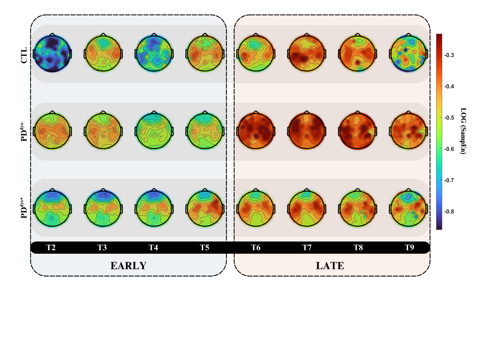
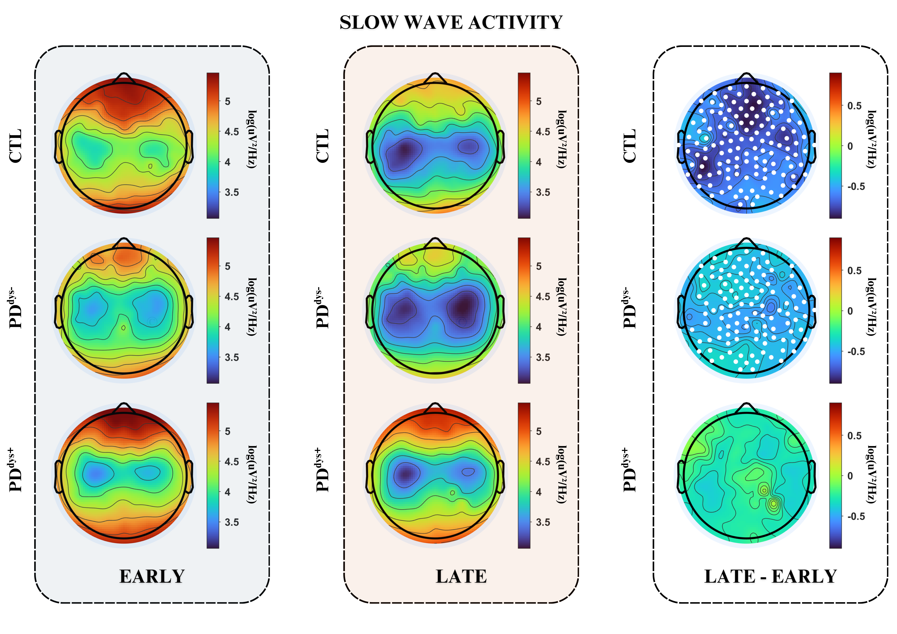
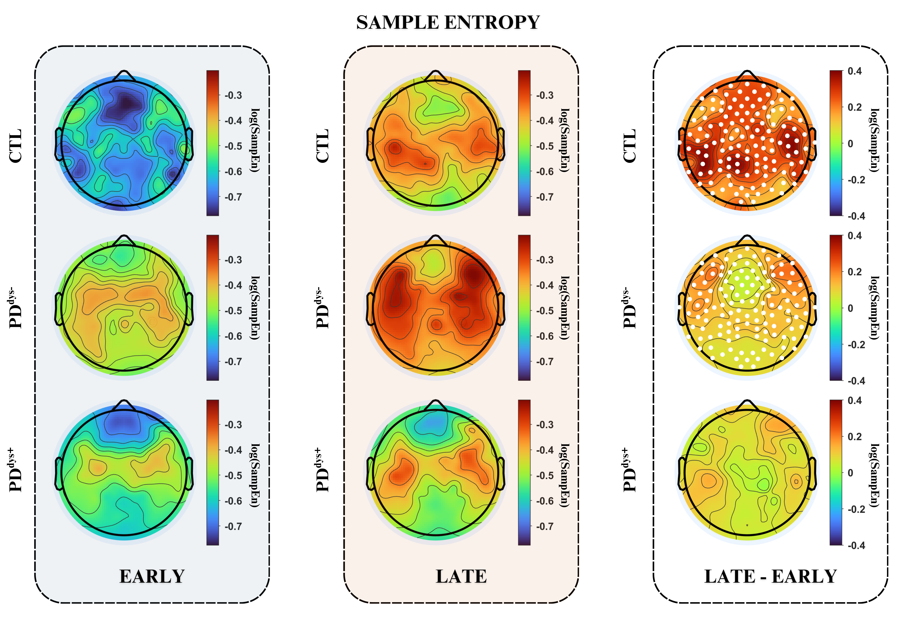
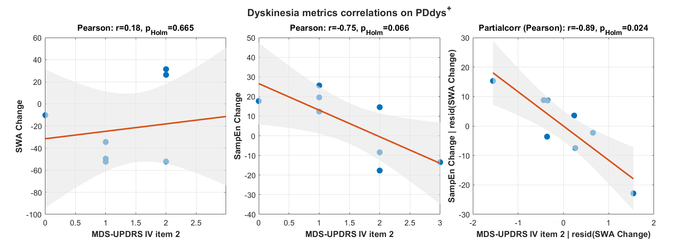

## Study Abstract

Parkinson's disease (PD) can progress to an advanced stage characterized by motor fluctuations and/or levodopa-induced dyskinesia (LID). Although both motor fluctuations and LID reflect altered dopaminergic reactivity, LID has been specifically linked to disrupted synaptic plasticity.

Slow wave sleep (N3) reflects homeostatic processes and may offer neurophysiological markers related to the motor phenotype in PD. This study tested whether overnight dynamics of N3 slow-wave activity (SWA) and cortical complexity, i.e., sample entropy (SampEn), differ between PD patients with and without dyskinesia, and whether these dynamics relate to dyskinesia severity.

Polysomnography (PSG) was analyzed in seven healthy volunteers and two PD cohorts: non-dyskinetic (PDdys-, n = 8) and dyskinetic (PDdys+, n = 10). NREM sleep was divided into 10 segments; SWA and SampEn were mapped across the scalp and summarized in Early/Late N3 windows. Within-group Late–Early changes were assessed using paired permutation tests with TFCE correction. Late–Early changes were then compared between groups, and associations with the functional impact of dyskinesia (MDS-UPDRS Part IV, item 4.2) were examined in PDdys+.

In CTL, SWA decreased and SampEn increased overnight (pTFCE < 0.001). PDdys- showed a similar but more restricted pattern, whereas PDdys+ showed no significant Late–Early change in either metric. In PDdys+, Late–Early SampEn change was inversely related to dyskinesia severity (r = −0.75, pHolm = 0.068) and remained strong after adjustment for SWA (r = −0.90, pHolm = 0.018).

These findings suggest that entropy-based measures capture dyskinesia-related alterations in nocturnal dynamics beyond SWA, providing a quantitative link between sleep neurophysiology and daytime motor complications in PD.

---

The MATLAB scripts are organized by analysis stage:

- **[demographics-clinical-analysis](demographics-clinical-analysis/)** — `cohort_demographics.m` generates the cohort demographics and clinical summary table.
- **[hdeeg-analysis/preprocessing](hdeeg-analysis/preprocessing/)** — `channel_preprocessing.m` selects EEG channels and prepares subject-level data.
- **[hdeeg-analysis/feature-extraction](hdeeg-analysis/feature-extraction/)** — `prepare_sampen_input.m` prepares entropy inputs; `swa_classic_n3.m` calculates N3 slow-wave activity.
- **[hdeeg-analysis/quality-control](hdeeg-analysis/quality-control/)** — `n3_availability.m` summarizes N3 coverage; `arousal_summary.m` summarizes epoch-level arousal and staging fields.
- **[hdeeg-analysis/statistical-models](hdeeg-analysis/statistical-models/)** — `swa_early_vs_late.m` and `sampen_early_vs_late.m` test within-group overnight changes; `roi_between_groups.m` compares regions across groups.
- **[correlation-analysis](correlation-analysis/)** — `swa_sampen_clinical_correlations.m` relates overnight EEG changes to clinical scores.

Run scripts after setting their input and output paths and installing the dependencies noted in each script. The datasets are not included in this repository.

The repository includes scripts for the main SWA and SampEn analyses, but the Python/EntropyHub step that computes per-epoch SampEn and the generator of `globalRes_SWA_CLAMP.mat` are not included. The statistical scripts require these external intermediate outputs. The available group comparison script analyzes raw Early/Late values; it does not implement every normalized-change analysis described in the paper.

---

## Data Access

The participant-level data and intermediate analysis files needed to rerun the scripts are not included in this repository. As stated in the paper, supporting data are available from the corresponding author upon reasonable request. Send data requests to [Salvatore Galati](mailto:salvatore.galati@eoc.ch).

---

## Subjects and Study Design

- A total of 27 individuals with advanced Parkinson’s disease (PD), diagnosed according to UK Parkinson’s Disease Society Brain Bank criteria, were enrolled and classified into:
  1. **PDdys- (n = 13)** – advanced PD with end‑of‑dose/wearing‑off motor fluctuations but no levodopa‑induced dyskinesia (LID)  
  2. **PDdys+ (n = 14)** – advanced PD with motor fluctuations and clinician‑confirmed LID  
- An age‑matched healthy control group (**CTL**, n = 12) was included, composed of relatives, nonclinical staff, and volunteers under the same protocol.

- Screening included mood and sleep questionnaires (modified Beck Depression Scale, Epworth Sleepiness Scale, Pittsburgh Sleep Quality Index) and standardized motor/disease assessments (MDS‑UPDRS parts I–III and Hoehn & Yahr staging; part IV plus AIMS in dyskinetic patients).

- All participants underwent one habituation night in the sleep laboratory, followed by a second night with vPSG‑hdEEG recording. Sleep‑related breathing disorders (apnea–hypopnea index > 5), major technical failures, and globally corrupted vPSG‑hdEEG signals led to exclusion from sleep analyses.

- Most PD patients were treated with a combination of L‑dopa and dopamine agonists; levodopa equivalent daily dose (LEDD) was computed using standard conversion formulas. Benzodiazepine use was documented in a minority of PD patients and was absent in controls.

- Exclusion criteria included cognitive impairment (MMSE ≤ 24) and age ≥ 75 years. Participants were monitored longitudinally; development of atypical parkinsonian syndromes or significant cognitive decline led to exclusion from follow‑up analyses.

- All participants provided written informed consent. The protocol was approved by the Cantonal Ethical Commission (2562CE) and registered at ClinicalTrials.gov (NCT02200887).

---

## Tables

- **Table I** – [Cohort demographics, medications, and subjective measures of depression and sleep quality](resources/TableI.pdf)  
- **Table II** – [Descriptive polysomnographic (PSG) sleep architecture](resources/TableII.pdf)

---

## Results

**Figure 1 SampEn dynamics across the night**

Figure 1 caption

Topographic maps of log‑transformed sample entropy (SampEn) during N3 after segmenting NREM sleep into 10 equal temporal bins. Segments T2–T9 are shown for each group (CTL, PDdys-, PDdys+; rows), with the EARLY portion of the night (T2–T5) on the left and the LATE portion (T6–T9) on the right. The color bar indicates log(SampEn) values, illustrating group‑specific spatial and temporal patterns of N3 complexity across the night.

---

**Figure 2 Late–Early changes in N3 slow‑wave activity**

Figure 2 caption

Topographic maps of log‑transformed slow‑wave activity (SWA) during N3 for the three groups (CTL, PDdys-, PDdys+; rows). The first two columns show SWA in the EARLY (T2–T5) and LATE (T6–T9) N3 windows; the third column displays the intranight difference (LATE–EARLY). White dots mark electrodes with significant Late–Early changes (within‑group paired permutation tests with TFCE correction, pTFCE < 0.05). EARLY and LATE share a common color scale, whereas the difference maps use a scale centered on zero.

---

**Figure 3 Late–Early changes in N3 sample entropy**

Figure 3 caption

Topographic maps of log‑transformed sample entropy (SampEn) during N3 for the three groups (CTL, PDdys-, PDdys+; rows). The first two columns show SampEn in the EARLY (T2–T5) and LATE (T6–T9) N3 windows; the third column displays the intranight difference (LATE–EARLY). White dots mark electrodes with significant Late–Early changes (within‑group paired permutation tests with TFCE correction, pTFCE < 0.05). EARLY and LATE share a common color scale, whereas the difference maps use a scale centered on zero.

---

**Figure 4 Association between frontal N3 dynamics and dyskinesia severity**

Figure 4 caption

Scatterplots showing frontal N3 normalized Late–Early changes in SWA and SampEn in the PDdys+ group plotted against dyskinesia severity (MDS‑UPDRS Part IV, item 4.2). Separate panels (from left to right) illustrate: the correlation between normalized Late–Early SWA change and the clinical score; the correlation between normalized Late–Early SampEn change and the clinical score; and the partial correlation between normalized Late–Early SampEn change and the clinical score after adjustment for normalized Late–Early SWA change. Each point represents one patient; regression lines and 95% confidence bands are shown together with the corresponding correlation coefficients and p‑values.

---

## Supplementary Material

Additional methodological details, extended results, and supporting figures are provided in the supplementary file:
[Supplementary Material (PDF)](resources/SupplementaryMaterial.pdf)

---

## Contact and Support

For data requests, methodology questions, or collaboration inquiries, please contact the corresponding author at: 
[salvatore.galati@eoc.ch](mailto:salvatore.galati@eoc.ch) or [luigi.fiorillo@eoc.ch](mailto:luigi.fiorillo@eoc.ch) or [giovanni.lombardi@eoc.ch](mailto:giovanni.lombardi@eoc.ch)

---
