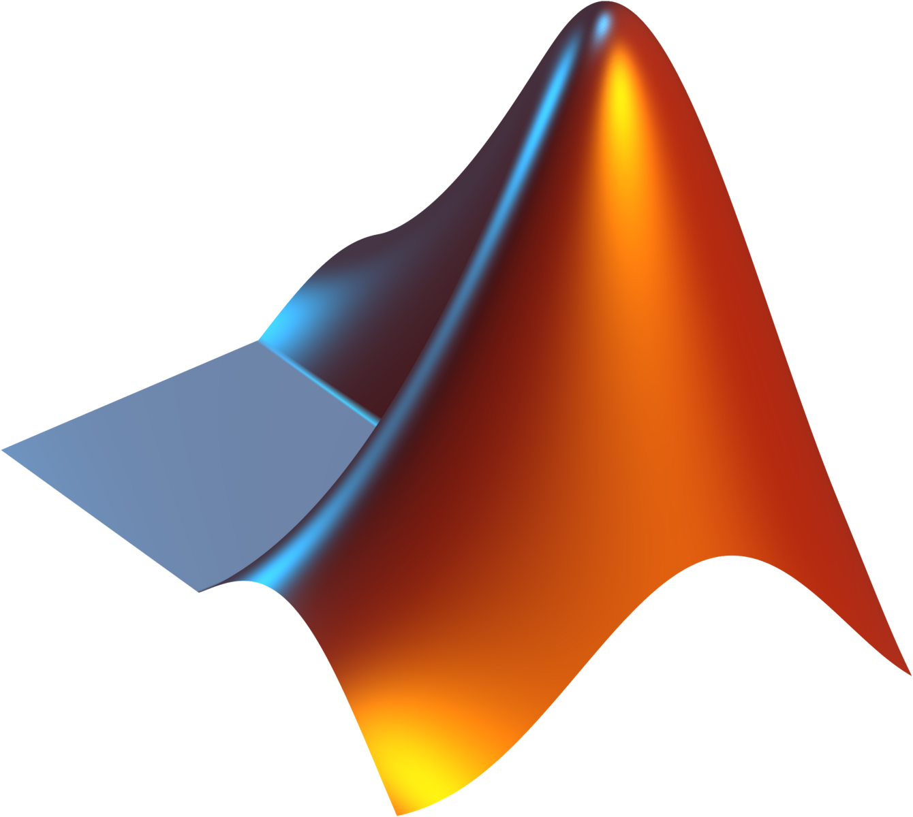
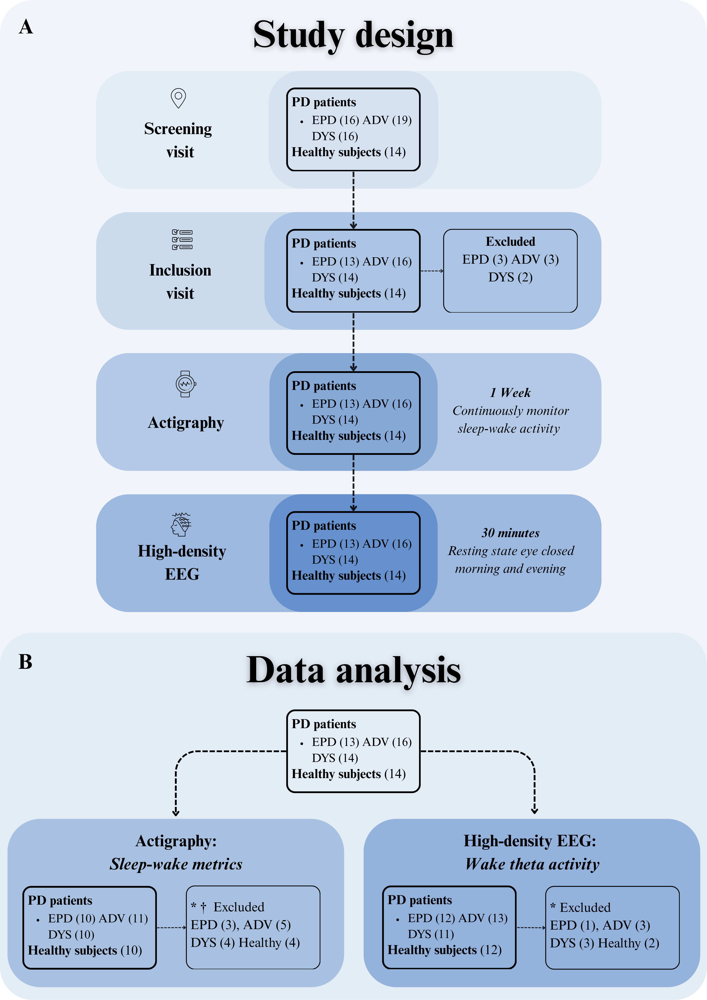
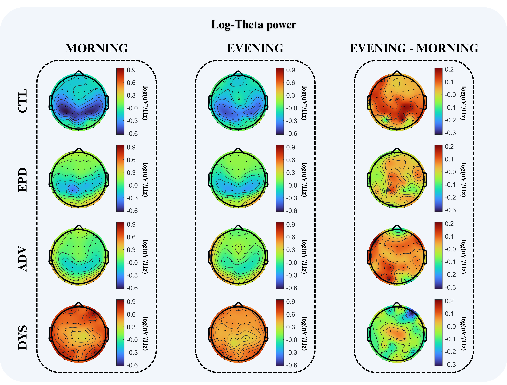
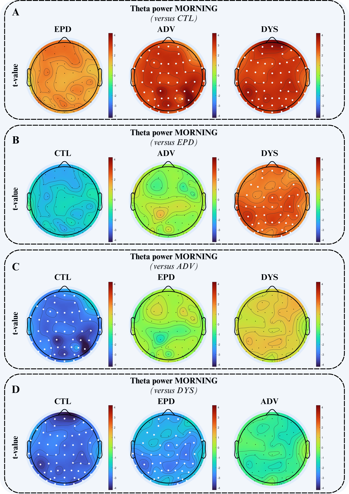
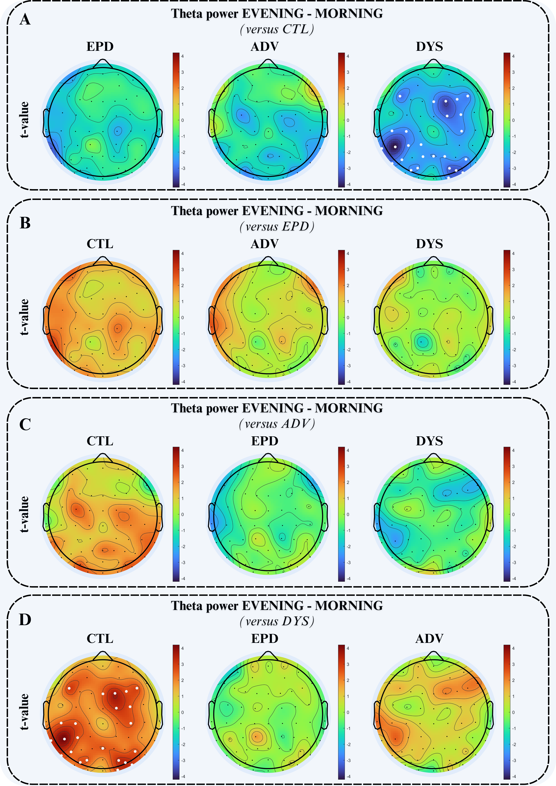
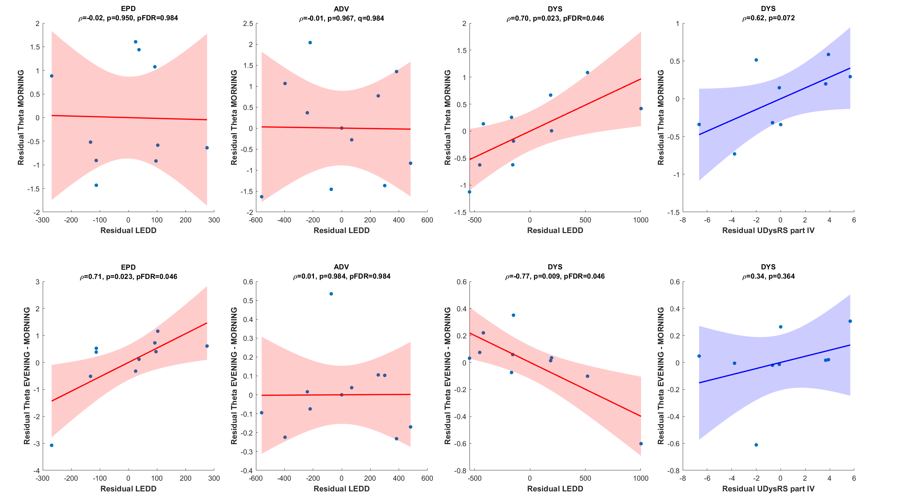

## Study Abstract

Slow-wave activity during sleep facilitates synaptic downscaling, while theta activity during wakefulness reflects synaptic upscaling, and both processes may be altered in levodopa-induced dyskinesia (LID) in Parkinson’s disease (PD).

We compared actigraphy and high-density EEG in 12 healthy volunteers and three PD cohorts: early stage (EPD, n = 12), advanced non-dyskinetic (ADV, n = 13), and advanced dyskinetic (DYS, n = 11). Participants completed one week of actigraphy monitoring, followed by two resting-state EEG recordings conducted separately in the morning and evening.

Wake-theta activity was analyzed using both linear and linear mixed-effects models, adjusted for age/sex, plus cluster-based non-parametric statistics. Results were then related to clinical variables and actigraphy-derived sleep metrics via partial correlations.

Dyskinetic patients showed marked sleep disruption, elevated morning theta compared with controls (p = 0.006, d = 1.54) and EPD (p = 0.03, d = 0.85), along with a significantly reduced diurnal theta build-up compared with controls (p = 0.009, d = 1.57). EPD and ADV groups showed preserved diurnal increases.

In dyskinetic patients, a higher levodopa equivalent daily dose (LEDD) was correlated with higher morning theta (ρ = 0.70, p = 0.023, pFDR = 0.046) and smaller diurnal theta increases (ρ = −0.77, p = 0.009, pFDR = 0.046). Relationships between theta and actigraphy-derived sleep metrics were weaker and inconsistent across groups.

These findings suggest a dyskinesia-specific profile of impaired wake-related theta homeostasis, motivating longitudinal studies combining polysomnography and waking EEG.

---

The repository contains these analysis folders:

- **actigraphy-analysis**   
  Processing and analyzing actigraphy data collected via GeneActiv inertial sensors worn on the participant’s nondominant wrist for one week. Data are preprocessed using the open-source R package [GGIR](https://cran.r-project.org/web/packages/GGIR/vignettes/GGIR.html), which extracts objective sleep-wake metrics (e.g., eSE, eTST, eWASO). These metrics allow for detailed, quantitative assessment and comparison of sleep-wake patterns across participant groups.

- **hdeeg-analysis**   
  Preprocessing and analysis of high-density EEG (hd-EEG) data recorded during two resting-state wakefulness sessions (morning and evening). Preprocessing includes filtering, artifact removal (including ICA for ocular, muscular, and cardiac artifacts), and channel interpolation. Power spectral density (PSD) is estimated for each channel using Welch’s method, with a specific focus on theta band activity (4–8 Hz, and its sub-bands). This enables the investigation of theta power as a marker of synaptic potentiation and its alterations in DYS.
  - **statistical-models** 
    Statistical analysis for **hd-EEG features** via modeling, including:
    - **Topoplots** for visualizing spatial distributions of theta power.
    - **Linear models (LMs)** and **Linear mixed-effects models (LMMs)** to assess within-group session differences (morning vs. evening) and between-group effects, adjusted for age and sex.
    - **Permutation-based correction** (Threshold-Free Cluster Enhancement) to address multiple comparisons across EEG channels.
    - **Effect size calculations** and spatial validation of significant findings.

- **correlation-analysis** 
  Evaluating the relationships between physiological signals (such as theta power from hd-EEG) and clinical metrics. Pearson’s correlation analyses are performed on model-adjusted residuals to minimize confounding, focusing on associations between theta power and variables like Levodopa Equivalent Daily Dose (LEDD) and Unified Dyskinesia Rating Scale (UDysRS) scores, particularly within regions and sessions showing significant effects.

The three analysis folders contain their own README files. The scripts use external datasets and paths that must be configured before running them.

The repository does not contain scripts for the paper's demographic, clinical, and actigraphy group-comparison tables or its supplementary actigraphy–theta correlations. These analyses require code or intermediate outputs from outside this repository.

---

## Data Access

The participant-level EEG, actigraphy, and clinical datasets needed to rerun the scripts are not included in this repository. As stated in the paper, they are not publicly available to protect patient confidentiality but are available from the corresponding author upon reasonable request. Send data requests to [Salvatore Galati](mailto:salvatore.galati@eoc.ch).

---

## Subjects and Study Design

- Participants included Parkinson’s disease (PD) patients classified into three groups based on disease stage:
  1. **Early-stage (EPD)** – recent diagnosis, no motor fluctuations  
  2. **Advanced (ADV)** – advanced PD with end-of-dose/wearing-off motor fluctuations but without LID  
  3. **Dyskinetic (DYS)** – advanced PD with motor fluctuations and levodopa-induced dyskinesia (LID)  
- An age- and sex-matched healthy control group (**CTL**) was recruited via word of mouth.

- Key inclusion criteria: PD diagnosis according to UK Parkinson’s Disease Society Brain Bank criteria, stable antiparkinsonian medication for ≥14 days, age 30–80 years, Hoehn & Yahr stage II–III, MoCA ≥ 26, and (for DYS) documented/observed LID > 25% of waking time (MDS-UPDRS Part IV, item 4.1).  
- Main exclusion criteria: comorbid psychiatric disorders, moderate–severe central sleep apnea, moderate–severe depression, significant concomitant diseases, or major sleep disorders.

- At inclusion, participants underwent neurological and physical examinations with MoCA, MDS‑UPDRS, H&Y, AIMS, and UDysRS. Non-motor symptoms were assessed with HADS (mood), and ESS, PSQI, and SCOPA‑Sleep (sleep).

- Sleep–wake patterns were monitored at home for one week using wrist-worn inertial sensors (GENEActiv) under instructions to maintain a regular sleep–wake schedule. Non‑compliant sleep–wake cycles led to exclusion from actigraphy-derived metrics.

- After actigraphy, two 30-minute wakefulness hd‑EEG sessions (morning and evening, ~9 hours apart) were recorded at home, including eyes open/closed and a go/no-go task. All PD patients were on stable, optimized antiparkinsonian therapy and were in the ON state during hd‑EEG.

- A total of 65 individuals were initially enrolled (14 CTL, 16 EPD, 19 ADV, 16 DYS). After screening exclusions, 14 CTL, 13 EPD, 16 ADV, and 14 DYS proceeded to data acquisition. Additional quality-based exclusions (artifacts/poor hd‑EEG or non‑compliant actigraphy) yielded a final hd‑EEG sample of 12 CTL, 12 EPD, 13 ADV, 11 DYS, and a joint actigraphy–EEG subset of 10 CTL, 10 EPD, 11 ADV, 10 DYS for correlation analyses.

**Figure 1 Study design and data analysis**

Figure 1 Caption

(A) Schematic flow chart showing participant enrollment, assessments, and data analysis. Following screening, eight patients (3 EPD, 3 ADV, 2 DYS) were excluded according to inclusion/exclusion criteria. At inclusion, participants underwent neurological and physical examinations and were equipped with inertial sensors for actigraphy monitoring. After one week of actigraphy, two 30‑minute eyes‑closed resting‑state wakefulness sessions (morning and evening) were recorded with high‑density EEG (hd‑EEG), spaced approximately nine hours apart. (B) Exclusions were applied separately for actigraphy and hd‑EEG analyses: participants with non‑compliant sleep–wake cycles were excluded from actigraphy‑derived metrics, while hd‑EEG exclusions were based on poor data quality or technical artifacts in morning/evening recordings. Subjects excluded from actigraphy analysis were additionally screened for hd‑EEG completeness, ensuring the final integrated cohort retained only individuals with high‑quality data across both modalities. ADV = advanced patients without dyskinesia; CTL = controls; DYS = advanced patients with dyskinesia; EPD = early‑stage patients.

---

## Tables

- **Table I** – [Cohort demographics, medications, and subjective measures of depression and sleep quality](resources/TableI.pdf)  
- **Table II** – [Weekly descriptive actigraphy data](resources/TableII.pdf)

---

## Results

**Figure 2 Morning, evening and diurnal dynamics of theta power across groups**

Figure 2 Caption

Topographical maps of log‑transformed theta power (4–8 Hz, units: log(uV²/Hz)) during morning, evening, and their diurnal difference (evening minus morning) in CTL, EPD, ADV, and DYS groups. Morning and evening maps were each normalized to their respective global minimum and maximum across all groups. CTL showed the lowest morning theta power, with progressively higher values in EPD and ADV and the highest levels in DYS. In the diurnal maps, CTL, EPD, and ADV displayed a visible increase in theta power from morning to evening, whereas DYS showed minimal diurnal change, qualitatively indicating a reduced daytime build‑up of theta activity. ADV = advanced patients without dyskinesia; CTL = controls; DYS = advanced patients with dyskinesia; EPD = early‑stage patients.

---

**Figure 3 Morning theta power differences across groups**

Figure 3 Caption

Group‑level topographical maps of t‑values from multiple linear regression (MLR) models of log‑transformed morning theta power (4–8 Hz, units: log(uV²/Hz)), adjusted for age and gender. Maps depict the direction and magnitude of group differences when contrasting each group with (A) CTL, (B) EPD, (C) ADV, and (D) DYS as the baseline (warm colors: higher theta than baseline; cool colors: lower theta than baseline). White dots mark electrodes with TFCE‑corrected significant effects (p < 0.05). ADV = advanced patients without dyskinesia; CTL = controls; DYS = advanced patients with dyskinesia; EPD = early‑stage patients.

---

**Figure 4 Diurnal theta power differences across groups**

Figure 4 Caption

Group‑level topographical maps of t‑values from linear mixed‑effects models (LMMs) of diurnal theta change (evening minus morning, 4–8 Hz, units: log(uV²/Hz)), adjusted for age and gender. Maps show the direction and magnitude of group differences when contrasting each group with (A) CTL, (B) EPD, (C) ADV, and (D) DYS as the baseline (warm colors: greater diurnal increase than baseline; cool colors: reduced diurnal increase than baseline). White dots indicate electrodes with TFCE‑corrected significant effects (p < 0.05). ADV = advanced patients without dyskinesia; CTL = controls; DYS = advanced patients with dyskinesia; EPD = early‑stage patients.

---

**Figure 5 Correlation between theta power, dopaminergic medication load, and dyskinesia severity**

Figure 5 Caption

Scatterplots in red show correlations between residual log‑transformed theta power measures (top row: morning theta; bottom row: diurnal theta change, defined as evening minus morning) and residual levodopa equivalent daily dose (LEDD), all adjusted for age and gender, in EPD, ADV, and DYS patients. Scatterplots in blue show correlations between residual log‑transformed theta power measures (top row: morning theta; bottom row: diurnal theta change) and residual Unified Dyskinesia Rating Scale (UDysRS) Part IV scores, adjusted for age and gender, in DYS patients. For LEDD‑related analyses, six subgroup correlations (three groups × two theta outcomes) were treated as a single family of tests, and Benjamini–Hochberg false discovery rate (BH–FDR) correction was applied, with both uncorrected and FDR‑adjusted p values reported in the panel labels. In DYS patients, higher LEDD was associated with higher morning theta power and a smaller diurnal theta increase, whereas no significant LEDD–morning theta correlations were observed in EPD or ADV, and a positive LEDD–diurnal theta association emerged only in EPD. In DYS patients, morning theta showed a positive but statistically inconclusive trend with UDysRS Part IV, and no clear association was observed for diurnal theta change. Each plot displays the best‑fit regression line and 95% confidence interval. ADV = advanced patients without dyskinesia; CTL = controls; DYS = advanced patients with dyskinesia; EPD = early‑stage patients; LEDD = levodopa equivalent daily dose; UDysRS Part IV = Unified Dyskinesia Rating Scale Part IV; n = 9 DYS patients contributed to UDysRS‑based analyses.

---

## Supplementary Material

Additional methodological details, extended results, and supporting figures are provided in the supplementary file:
[Supplementary Material (PDF)](resources/SupplementaryMaterial.pdf)

---

## Contact and Support

For data requests, methodology questions, or collaboration inquiries, please contact the corresponding author at: 
[salvatore.galati@eoc.ch](mailto:salvatore.galati@eoc.ch) or [luigi.fiorillo@eoc.ch](mailto:luigi.fiorillo@eoc.ch) or [giovanni.lombardi@eoc.ch](mailto:giovanni.lombardi@eoc.ch)

---
